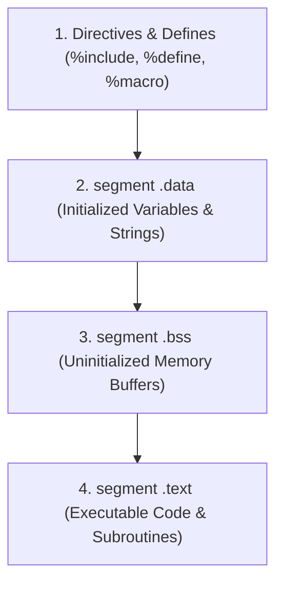

# .e8085 Language & Syntax Reference Manual

This manual provides the definitive specification and reference guide for the `.e8085` assembly language, the built-in assembler, preprocessor, memory segments, instruction set, and device libraries in `emu8085`. It serves as the primary technical reference for human developers and autonomous AI agents.

---

## Table of Contents
1. [Core Language Rules & Segment Architecture](#1-core-language-rules--segment-architecture)
2. [Data Types & The 4 Number Systems](#2-data-types--the-4-number-systems)
3. [Memory Segments in Detail](#3-memory-segments-in-detail)
4. [Preprocessor Directives](#4-preprocessor-directives)
5. [Parameterized Macros](#5-parameterized-macros)
6. [Labels, Scoping & Linker Declarations](#6-labels-scoping--linker-declarations)
7. [Hardware Vector Table & Interrupt Handlers](#7-hardware-vector-table--interrupt-handlers)
8. [Intel 8085 Architecture & Instruction Set](#8-intel-8085-architecture--instruction-set)
9. [Standard Library & Devices](#9-standard-library--devices)
10. [Complete Annotated Program Example](#10-complete-annotated-program-example)
11. [Agent & Developer Checklist](#11-agent--developer-checklist)

---

## 1. Core Language Rules & Segment Architecture

### Strict Program Structure & Segment Ordering
An `.e8085` program adheres to a strict, non-interleaved structural layout:



> [!IMPORTANT]
> **Strict Segment Constraints**:
> 1. **`%define` Before Segments**: All `%define` constants and preprocessor expressions **must appear at the top of the file, before any segment declaration**. Placing a `%define` after a `segment` statement triggers a compile-time error (`DefineAfterSegment`).
> 2. **No Mixed or Duplicate Segments**: Segments **cannot be mixed, scattered, or declared multiple times**. Each segment (`segment .data`, `segment .bss`, `segment .text`) can be declared at most once per file. You cannot open `.data`, start `.text`, and then return to `.data`.
> 3. **Segment Roles**:
>    - `segment .data` contains **all initialized variables, strings, and byte tables**.
>    - `segment .bss` contains **all uninitialized RAM space reservations**.
>    - `segment .text` contains **all executable instructions, labels, subroutines, and ISR handlers**.

### Syntax & Punctuation Rules
- **Comments**: A semicolon (`;`) starts a comment that extends to the end of the line.
- **Case Sensitivity**:
  - Instruction mnemonics (`mov`, `MOV`), registers (`a`, `A`, `hl`, `HL`), segment names (`.data`, `.DATA`), and size specifiers (`byte`, `word`) are **case-insensitive**.
  - Identifiers for labels, variables, and macros are **case-preserving**.
  - By convention, `%define` constants use `UPPER_SNAKE_CASE` (`MAX_WIDTH`, `COLOR_RED`).
- **Code Labels vs Data Variables**:
  - Code labels in `segment .text` **must have a trailing colon**: `main:`, `.loop:`.
  - Variables in `segment .data` and `segment .bss` **must NOT have a colon**: `counter byte 0` (correct), `counter: byte 0` (syntax error).
- **Program Entry Point**:
  - Execution begins at `main:`. The assembler generates a 3-byte reset jump (`jmp main`) at reset address `0x0000`.
  - Non-looping paths must explicitly terminate with `hlt`.

---

## 2. Data Types & The 4 Number Systems

### Valid Data Types & Size Specifiers
The language supports two fundamental data sizes, valid in both `segment .data` and `segment .bss`:

| Type | Case-Insensitive Specifiers | Bit Width | Value Range | Memory Representation |
| :--- | :--- | :---: | :---: | :--- |
| **Byte** | `byte`, `BYTE` | 8 bits | `0` to `255` (`0x00`..`0xFF`) | 1 byte in memory |
| **Word** | `word`, `WORD` | 16 bits | `0` to `65535` (`0x0000`..`0xFFFF`) | 2 bytes in memory (**Little-Endian**: low byte first, high byte second) |

### The 4 Number Systems (4 Number Bases)
Numbers can be written in decimal, hexadecimal, binary, or octal. Visual underscore digit separators (`_`) are permitted anywhere within numbers across all 4 bases:

| Base / Number System | Prefix / Format | Example Literals | Decimal Value |
| :--- | :--- | :--- | :---: |
| **Decimal** (Base 10) | *(No prefix)* | `42`, `255`, `1000`, `65_535` | 42, 255, 1000, 65535 |
| **Hexadecimal** (Base 16) | `0x` or `0X` | `0x2A`, `0xFF`, `0XF00F`, `0x12_34` | 42, 255, 61455, 4660 |
| **Binary** (Base 2) | `0b` or `0B` | `0b0010_1010`, `0B1111_1111` | 42, 255 |
| **Octal** (Base 8) | `0o` or `0O` | `0o52`, `0O377`, `0o12_34` | 42, 255, 668 |

### Character & String Literals
- **Character Literals (`'x'`)**:
  - Enclosed in single quotes.
  - Treated as 1-byte numeric constants (`'A'` = `65` / `0x41`).
  - Allowed anywhere an 8-bit immediate is accepted: `mvi A, 'A'`, `cpi '\n'`, in `%define`, or in `.data`.
- **String Literals (`"..."`)**:
  - Enclosed in double quotes.
  - Emits the sequence of ASCII bytes.
  - Strings are **not automatically null-terminated**; append `\0` or `, 0` when passing to string subroutines.
- **Supported Escape Sequences**:
  - `\n` : Line feed (ASCII `0x0A`)
  - `\r` : Carriage return (ASCII `0x0D`)
  - `\t` : Horizontal tab (ASCII `0x09`)
  - `\0` : Null byte (ASCII `0x00`)
  - `\\` : Literal backslash
  - `\'` : Literal single quote
  - `\"` : Literal double quote
  - `\xHH` : Exact 2-digit hexadecimal byte (e.g. `\x1B` for Escape)

---

## 3. Memory Segments in Detail

```e8085
; Segment Declarations Example
segment .data
    msg    byte "Hello 8085!\n\0"
    lut    byte 0x01, 0x02, 0x04, 0x08
    stack  word 0x1000, 0x2000

segment .bss
    buffer byte 64
    cursor word 1

segment .text
main:
    lxi SP, 0xF000
    hlt
```

### Physical Memory Layout
```text
+-----------------------+ 0x0000  Reset / Bootstrap (JMP main)
| Vector Table (64B)    | 0x0008..0x003F Interrupt Vectors (RST 1..7, TRAP, RST 5.5..7.5)
+-----------------------+ 0x0040  DATA_BASE
| segment .data         | Initialized strings, tables, constants
+-----------------------+
| segment .bss          | Zero-initialized RAM buffer reservations
+-----------------------+
| segment .text         | Machine instructions, subroutines, ISR handlers
+-----------------------+
| Stack (Grows Down)    | Typically placed at top of RAM (e.g. 0xF000)
+-----------------------+
```

### 3.1 `segment .data` (Initialized Memory)
- Starts immediately after the 64-byte vector table at `0x0040` (`DATA_BASE`).
- Stores initialized data tables, strings, and lookup values.
- Values can be separated by spaces or commas.
- Supports the `%repeat` directive to duplicate values.

```e8085
segment .data
counter   byte 0x00
primes    byte 2, 3, 5, 7, 11, 13
palette   word 0xF00F, 0x0F0F, 0x00FF    ; 16-bit words (Little-Endian)
padding   byte %repeat 16 0xFF           ; 16 bytes of 0xFF
title_str byte "Retro Arcade\0"
```

### 3.2 `segment .bss` (Uninitialized RAM Reservations)
- Placed in RAM immediately following `.data`.
- Reserves zero-filled space.
- Syntax: `<identifier> <size> <count>`.
- The `<count>` specifies the number of `byte` or `word` units to reserve.

```e8085
segment .bss
rx_buffer  byte 128     ; 128 bytes reserved
coord_x    byte 1       ; 1 byte reserved
coord_y    byte 1       ; 1 byte reserved
history    word 16      ; 16 words (32 bytes) reserved
```

### 3.3 `segment .text` (Executable Code)
- Placed immediately following `.bss`.
- Contains microprocessor instructions, subroutines, labels, and interrupt service routines.
- Must contain an entry point label named `main:`.

---

## 4. Preprocessor Directives

All `%define` and `%include` directives must appear before any segment declaration.

### 4.1 Static Constant Definitions (`%define`)
Defines named constants up to 16 bits (`0x0000` to `0xFFFF`). Supports define chaining:
```e8085
%define PORT_DATA    0x11
%define MAX_ITEMS    100
%define COLOR_RED    0xF00F
%define ESCAPE_KEY   0x1B
%define DEFAULT_PORT PORT_DATA   ; Define chaining
```

### 4.2 Static Expression Evaluation
`%define` evaluates static integer arithmetic and bitwise expressions at assembly time:
- **Arithmetic**: `+`, `-`, `*`, `/` (integer division), `%` (modulo)
- **Bitwise**: `<<` (shift left), `>>` (shift right), `&` (AND), `|` (OR), `^` (XOR), `~` (NOT)
- **Grouping**: Parentheses `(...)` control precedence

```e8085
%define SCREEN_W     160
%define SCREEN_H     90
%define PIXEL_COUNT  SCREEN_W * SCREEN_H            ; 14,400
%define ROW_STRIDE   (1 << 8)                       ; 256
%define ALIGN_16(x)  (x + 15) & ~15                 ; Aligns to 16-byte boundary
%define BUFFER_BYTES (SCREEN_W * 2) + 32
```

### 4.3 Functional Directives
Functional directives take arguments, evaluate expressions, or emit multi-operand patterns:
```e8085
; Compute 16-bit RGBA4444 color:
%define Rgb(r, g, b) (((r & 0xF) << 12) | ((g & 0xF) << 8) | ((b & 0xF) << 4) | 0xF)

; Parameter pack directive:
%define Rect(x, y, w, h) x, y, w, h

segment .text
main:
    lxi HL, Rgb(0xF, 0, 0)      ; Assembles as: lxi HL, 0xF00F
```

### 4.4 Data Duplication (`%repeat`)
Repeats expressions or strings within `segment .data`:
```e8085
%define TILE_COUNT 8

segment .data
empty_grid  byte %repeat TILE_COUNT 0
grid_border byte %repeat 16 "="
chess_row   byte %repeat 4 0xAA 0x55
```

### 4.5 Buffer Size Queries (`%len`)
Evaluates to the exact byte size of a previously declared `.data` array or `.bss` buffer. Uses space-separated syntax (no parentheses):
```e8085
segment .data
msg byte "Connecting...\n\0"

segment .text
main:
    mvi B, %len msg             ; Loads B with byte length (15)
    lxi HL, msg
```

### 4.6 File Inclusion (`%include`)
Imports standard libraries, device definitions, or other `.e8085` source files:
- **Standard Library / Devices**: `%include <device/canvas>` or `%include <device/text_io>`
- **Local Quoted Path**: `%include "math/vector.e8085"`
- **Local Raw Path**: `%include math/vector.e8085`

Includes are transitively resolved with circular inclusion protection.

### 4.7 Conditional Compilation
Enables or disables blocks of code based on static conditions:
- Directives: `%if`, `%elif`, `%else`, `%endif`, `%ifdef`, `%ifndef`
- Relational operators: `==`, `!=`, `<`, `<=`, `>`, `>=`

```e8085
%define TARGET_PLATFORM 1

segment .text
main:
%ifdef TARGET_PLATFORM
    %if TARGET_PLATFORM == 1
        mvi A, 0x01
    %elif TARGET_PLATFORM == 2
        mvi A, 0x02
    %else
        mvi A, 0x00
    %endif
%endif
    hlt
```

---

## 5. Parameterized Macros

Macros define reusable instruction templates with positional parameter substitution.

### Syntax
```e8085
%macro <name> <param_count>
    ; Statements using %1, %2, ... %N
%end
```

### Features & Rules
1. **Positional Arguments**: `%1` represents the first argument, `%2` the second, and `%N` the $N$-th argument.
2. **Macro Overloading by Arity**: Multiple macros may share the **same name with different parameter counts**. The assembler dispatches to the macro matching the call site argument count:
   ```e8085
   ; Clear with 1 argument (16-bit color)
   %macro Clear 1
       lxi HL, %1
       call canvas_clear
   %end

   ; Clear with 2 arguments (split 8-bit components)
   %macro Clear 2
       mvi H, %1
       mvi L, %2
       call canvas_clear
   %end
   ```
3. **Local Labels Inside Macros**: Local labels (`.loop`, `.done`) inside macros are isolated per expansion, preventing duplicate label collisions across multiple calls.
4. **Nesting**: Macros can call other macros up to a recursion depth limit of 64.

### Example Macro
```e8085
%macro CopyBytes 3
    lxi HL, %1      ; Source address
    lxi DE, %2      ; Destination address
    mvi B, %3       ; Count
.copy_loop:
    mov A, M
    stax DE
    inx HL
    inx DE
    dcr B
    jnz .copy_loop
%end

segment .text
    CopyBytes src_buf, dst_buf, 32
```

---

## 6. Labels, Scoping & Linker Declarations

### Global Labels
Declared with a trailing colon:
```e8085
game_loop:
    call check_input
    call render_scene
    jmp game_loop
```

### Scoped Local Labels
Labels beginning with a period (`.`) are private to the preceding global label. They prevent namespace pollution:
```e8085
read_line:
    lxi HL, buffer
.char_loop:
    in 0x01
    cpi '\n'
    jz .done
    mov M, A
    inx HL
    jmp .char_loop
.done:
    mvi M, 0
    ret
```

### Linker Declarations: `global` & `extern`
For multi-module programs linked via the assembler/linker:
- `global <label>:`: Marks a label as exported and public.
- `extern <label>`: Declares that a symbol will be resolved from an included or linked module.
- `global main` is forbidden (`main` is automatically public as the reset entry point).

```e8085
; In file_io.e8085
global read_block:
read_block:
    ; ...
    ret

; In main.e8085
extern read_block
main:
    call read_block
    hlt
```

---

## 7. Hardware Vector Table & Interrupt Handlers

The Intel 8085 reserves memory locations `0x0000` through `0x003F` for hardware reset and interrupt vectors. When recognized ISR label names appear in your program, the assembler automatically writes a 3-byte jump instruction (`JMP <label>`) into the corresponding vector slot:

| Vector Address | Hardware / Software Trigger | Recognized ISR Labels |
| :---: | :--- | :--- |
| **`0x0000`** | Power-on Reset / `RST 0` | `main` |
| **`0x0008`** | Software `RST 1` | `isr_rst1`, `rst1_isr`, `isr_rst_1` |
| **`0x0010`** | Software `RST 2` | `isr_rst2`, `rst2_isr`, `isr_rst_2` |
| **`0x0018`** | Software `RST 3` | `isr_rst3`, `rst3_isr`, `isr_rst_3` |
| **`0x0020`** | Software `RST 4` | `isr_rst4`, `rst4_isr`, `isr_rst_4` |
| **`0x0024`** | Non-Maskable `TRAP` | `isr_trap`, `trap_isr`, `isr_trap_handler` |
| **`0x0028`** | Software `RST 5` | `isr_rst5`, `rst5_isr`, `isr_rst_5` |
| **`0x002C`** | Hardware Maskable `RST 5.5` | `isr_rst55`, `rst55_isr`, `isr_rst_5_5` |
| **`0x0030`** | Software `RST 6` | `isr_rst6`, `rst6_isr`, `isr_rst_6` |
| **`0x0034`** | Hardware Maskable `RST 6.5` | `isr_rst65`, `rst65_isr`, `isr_rst_6_5` |
| **`0x0038`** | Software `RST 7` | `isr_rst7`, `rst7_isr`, `isr_rst_7` |
| **`0x003C`** | Hardware Maskable `RST 7.5` | `isr_rst75`, `rst75_isr`, `isr_rst_7_5` |

---

## 8. Intel 8085 Architecture & Instruction Set

### Register Architecture
```text
+-------------------+-------------------+
|  Accumulator (A)  |    Flags (F)      | -> PSW (Program Status Word)
+-------------------+-------------------+
|  Register B (8b)  |  Register C (8b)  | -> BC Register Pair (16b)
+-------------------+-------------------+
|  Register D (8b)  |  Register E (8b)  | -> DE Register Pair (16b)
+-------------------+-------------------+
|  Register H (8b)  |  Register L (8b)  | -> HL Register Pair (16b) / Pointer [HL] = M
+-------------------+-------------------+
|            Stack Pointer (SP)         | -> 16-bit Stack Address
+---------------------------------------+
|           Program Counter (PC)        | -> 16-bit Next Instruction Pointer
+---------------------------------------+
```

### Flags Register (`F`)
- **S (Sign)**: Bit 7. Set if MSB of result is 1 (negative).
- **Z (Zero)**: Bit 6. Set if result is zero.
- **AC (Auxiliary Carry)**: Bit 4. Set on BCD nibble carry from bit 3 to 4.
- **P (Parity)**: Bit 2. Set if result has even number of 1-bits.
- **CY (Carry)**: Bit 0. Set on arithmetic overflow or borrow.

### Complete Instruction Catalog

#### 1. Data Transfer Group
| Mnemonic | Operands | Bytes | Cycles | Description | Example |
| :--- | :--- | :---: | :---: | :--- | :--- |
| `mov` | `r1, r2` | 1 | 4 / 7 (M) | Move byte from `r2` to `r1`. `r \in \{A, B, C, D, E, H, L, M\}` | `mov A, B`, `mov M, A` |
| `mvi` | `r, imm8` | 2 | 7 / 10 (M) | Move 8-bit immediate into register `r` | `mvi A, 0x55`, `mvi M, 0` |
| `lxi` | `rp, imm16`| 3 | 10 | Load 16-bit immediate into pair `rp \in \{BC, DE, HL, SP\}` | `lxi HL, 0x1234`, `lxi SP, 0xF000` |
| `lda` | `addr` | 3 | 13 | Load Accumulator directly from memory address | `lda 0x2000`, `lda score` |
| `sta` | `addr` | 3 | 13 | Store Accumulator directly to memory address | `sta 0x2000`, `sta result` |
| `lhld` | `addr` | 3 | 16 | Load `HL` pair directly from memory (`L=[addr], H=[addr+1]`) | `lhld ptr` |
| `shld` | `addr` | 3 | 16 | Store `HL` pair directly to memory (`[addr]=L, [addr+1]=H`) | `shld ptr` |
| `ldax` | `B` / `D` | 1 | 7 | Load `A` indirect from memory pointed to by `BC` or `DE` | `ldax BC`, `ldax D` |
| `stax` | `B` / `D` | 1 | 7 | Store `A` indirect to memory pointed to by `BC` or `DE` | `stax BC`, `stax D` |
| `xchg` | *none* | 1 | 4 | Exchange contents of `HL` and `DE` pairs | `xchg` |

#### 2. Arithmetic Group
| Mnemonic | Operands | Bytes | Cycles | Flags | Description | Example |
| :--- | :--- | :---: | :---: | :---: | :--- | :--- |
| `add` | `r` / `M` | 1 | 4 / 7 | All | `A = A + r` | `add B`, `add M` |
| `adi` | `imm8` | 2 | 7 | All | `A = A + imm8` | `adi 10` |
| `adc` | `r` / `M` | 1 | 4 / 7 | All | `A = A + r + CY` | `adc C` |
| `aci` | `imm8` | 2 | 7 | All | `A = A + imm8 + CY` | `aci 1` |
| `sub` | `r` / `M` | 1 | 4 / 7 | All | `A = A - r` | `sub B`, `sub M` |
| `sui` | `imm8` | 2 | 7 | All | `A = A - imm8` | `sui 5` |
| `sbb` | `r` / `M` | 1 | 4 / 7 | All | `A = A - r - CY` | `sbb D` |
| `sbi` | `imm8` | 2 | 7 | All | `A = A - imm8 - CY` | `sbi 0` |
| `inr` | `r` / `M` | 1 | 4 / 10 | S, Z, AC, P | Increment `r` by 1 (**CY unaffected**) | `inr A`, `inr M` |
| `dcr` | `r` / `M` | 1 | 4 / 10 | S, Z, AC, P | Decrement `r` by 1 (**CY unaffected**) | `dcr C`, `dcr M` |
| `inx` | `rp` | 1 | 6 | None | Increment 16-bit register pair | `inx HL`, `inx SP` |
| `dcx` | `rp` | 1 | 6 | None | Decrement 16-bit register pair | `dcx BC` |
| `dad` | `rp` | 1 | 10 | CY | Double addition: `HL = HL + rp` | `dad BC`, `dad SP` |
| `daa` | *none* | 1 | 4 | All | Decimal Adjust Accumulator for BCD | `daa` |

#### 3. Logical Group
| Mnemonic | Operands | Bytes | Cycles | Flags | Description | Example |
| :--- | :--- | :---: | :---: | :---: | :--- | :--- |
| `ana` | `r` / `M` | 1 | 4 / 7 | S, Z, P (CY=0, AC=1) | Logical AND with Accumulator | `ana B`, `ana M` |
| `ani` | `imm8` | 2 | 7 | S, Z, P (CY=0, AC=1) | Logical AND immediate | `ani 0x0F` |
| `ora` | `r` / `M` | 1 | 4 / 7 | S, Z, P (CY=0, AC=0) | Logical OR with Accumulator | `ora C` |
| `ori` | `imm8` | 2 | 7 | S, Z, P (CY=0, AC=0) | Logical OR immediate | `ori 0x80` |
| `xra` | `r` / `M` | 1 | 4 / 7 | S, Z, P (CY=0, AC=0) | Logical XOR (`xra A` clears A & CY) | `xra A` |
| `xri` | `imm8` | 2 | 7 | S, Z, P (CY=0, AC=0) | Logical XOR immediate | `xri 0xFF` |
| `cmp` | `r` / `M` | 1 | 4 / 7 | All | Compare `r` with `A` (`A - r`, updates flags) | `cmp B`, `cmp M` |
| `cpi` | `imm8` | 2 | 7 | All | Compare immediate with `A` | `cpi 0x00` |
| `rlc` | *none* | 1 | 4 | CY | Rotate Left Circular (`A[7]->CY, A[7]->A[0]`) | `rlc` |
| `rrc` | *none* | 1 | 4 | CY | Rotate Right Circular (`A[0]->CY, A[0]->A[7]`) | `rrc` |
| `ral` | *none* | 1 | 4 | CY | Rotate Left through Carry | `ral` |
| `rar` | *none* | 1 | 4 | CY | Rotate Right through Carry | `rar` |
| `cma` | *none* | 1 | 4 | None | Complement Accumulator (`A = ~A`) | `cma` |
| `cmc` | *none* | 1 | 4 | CY | Complement Carry Flag (`CY = !CY`) | `cmc` |
| `stc` | *none* | 1 | 4 | CY | Set Carry Flag (`CY = 1`) | `stc` |

#### 4. Branching & Control Group
| Mnemonic | Condition | Description | Example |
| :--- | :--- | :--- | :--- |
| `jmp addr` | Unconditional | Jump directly to address | `jmp game_loop` |
| `jz addr` / `jnz addr` | Zero / Not Zero | Branch if `Z == 1` / `Z == 0` | `jz is_zero`, `jnz retry` |
| `jc addr` / `jnc addr` | Carry / No Carry | Branch if `CY == 1` / `CY == 0` | `jc overflow` |
| `jm addr` / `jp addr` | Minus / Plus | Branch if `S == 1` / `S == 0` | `jm negative` |
| `jpe addr` / `jpo addr` | Parity Even / Odd | Branch if `P == 1` / `P == 0` | `jpe even_parity` |
| `pchl` | Unconditional | Move `HL` to `PC` (`PC = HL`, computed jump) | `pchl` |
| `call addr` | Unconditional | Subroutine call (pushes `PC` to stack) | `call render_scene` |
| `cz`, `cnz`, `cc`, `cnc`, etc. | Conditional | Conditional subroutine call | `cz clear_all` |
| `ret` | Unconditional | Return from subroutine (pops `PC`) | `ret` |
| `rz`, `rnz`, `rc`, `rnc`, etc. | Conditional | Conditional subroutine return | `rz`, `rnc` |
| `rst n` | Unconditional | Software interrupt restart ($n \in \{0..7\}$, jumps to $n \times 8$) | `rst 1`, `rst 7` |

#### 5. Stack & Machine Control Group
| Mnemonic | Operands | Bytes | Cycles | Description | Example |
| :--- | :--- | :---: | :---: | :--- | :--- |
| `push` | `rp` / `PSW` | 1 | 11 / 12 | Push 16-bit register pair or PSW onto stack | `push BC`, `push PSW` |
| `pop` | `rp` / `PSW` | 1 | 10 | Pop 16-bit pair or PSW from stack | `pop BC`, `pop PSW` |
| `xthl` | *none* | 1 | 16 | Exchange top of stack with `HL` pair | `xthl` |
| `sphl` | *none* | 1 | 6 | Move `HL` to Stack Pointer `SP` | `sphl` |
| `in` | `port` | 2 | 10 | Read byte from peripheral port into `A` | `in 0x11` |
| `out` | `port` | 2 | 10 | Output byte from `A` to peripheral port | `out 0x10` |
| `ei` / `di` | *none* | 1 | 4 | Enable / Disable maskable interrupts | `ei`, `di` |
| `sim` / `rim` | *none* | 1 | 4 | Set Interrupt Mask / Read Interrupt Mask | `sim`, `rim` |
| `nop` | *none* | 1 | 4 | No operation | `nop` |
| `hlt` | *none* | 1 | 5 / 7 | Halt processor execution | `hlt` |

---

## 9. Standard Library & Devices

### 9.1 Canvas Device (`<device/canvas>`)
Provides hardware-accelerated 2D graphics rendering in an 8-bit logical coordinate space ($0 \le X, Y \le 255$) with fixed $4\times 4$ physical pixel scaling.

#### 16-bit RGBA4444 Color Constants
```e8085
COLOR_BLACK       = 0x000F    COLOR_YELLOW      = 0xFF0F
COLOR_WHITE       = 0xFFFF    COLOR_CYAN        = 0x0FFF
COLOR_RED         = 0xF00F    COLOR_MAGENTA     = 0xF0FF
COLOR_GREEN       = 0x0F0F    COLOR_GRAY        = 0x888F
COLOR_BLUE        = 0x00FF    COLOR_TRANSPARENT = 0x0000
```

#### Drawing Macros (Subroutine-Backed)
- `InitCanvas(w: imm8, h: imm8, title: addr)`
- `DisposeCanvas()`
- `UpdateCanvas()`
- `Clear(color: Color)`
- `SetPixel(x: imm8, y: imm8, color: Color)`
- `GetPixel(x: imm8, y: imm8)` (Returns color in `BC`)
- `FillRect(x: imm8, y: imm8, w: imm8, h: imm8, color: Color)`
- `StrokeRect(x: imm8, y: imm8, w: imm8, h: imm8, color: Color)`
- `FillCircle(cx: imm8, cy: imm8, r: imm8, color: Color)`
- `StrokeCircle(cx: imm8, cy: imm8, r: imm8, color: Color)`
- `Line(x1: imm8, y1: imm8, x2: imm8, y2: imm8, color: Color)`
- `DrawHLine(x: imm8, y: imm8, len: imm8, color: Color)`
- `DrawVLine(x: imm8, y: imm8, len: imm8, color: Color)`
- `DrawText(str: addr, x: imm8, y: imm8, color: Color)`
- `DrawSprite(x: imm8, y: imm8, w: imm8, h: imm8, mask: addr, color: Color)`

#### User Input
- `KeyDown(key: imm8)` / `KeyPress(key: imm8)` / `KeyRelease(key: imm8)`
- `KeyInput()` (Pops key code into `A`)
- `MouseDown(btn: imm8)` / `MousePress(btn: imm8)` (`MOUSE_BUTTON_LEFT = 0`)
- `MousePosition()` (Loads $X$ into $B$ and $Y$ into $C$)

### 9.2 Text I/O Device (`<device/text_io>`)
Provides terminal stream output and line input:
- `PrintStr(str: addr, len: imm8)`
- `PrintChar(ch: imm8)`
- `ReadLine(buf: addr, max_len: imm8)`

---

## 10. Complete Annotated Program Example

```e8085
; ==============================================================================
; Interactive Canvas Demo with State Loop & Subroutines
; ==============================================================================

%include <device/canvas>

; All %defines must appear before any segment declaration
%define PADDLE_W   4
%define PADDLE_H   20
%define PADDLE_X   10
%define BG_COLOR   0x002F

segment .data
title_str byte "8085 Interactive Demo\0"
score_lbl byte "SCORE: 00\0"

segment .bss
paddle_y  byte 1
score     byte 1

segment .text
main:
    ; 1. Stack Initialization
    lxi SP, 0xF000

    ; 2. Initialize Canvas Window (160x90 logical, 640x360 physical)
    InitCanvas RES_DEFAULT_W, RES_DEFAULT_H, title_str
    SetFPS 30

    ; 3. Initial State Setup
    mvi A, 35
    sta paddle_y
    xra A
    sta score

game_loop:
    ; Check if window is open
    IsCanvasOpen
    jz game_exit

    ; Check ESC key to exit
    KeyDown K_ESCAPE
    jnz game_exit

    ; Check input (Up / Down arrows)
    KeyDown K_ARROW_UP
    jnz .move_up
    KeyDown K_ARROW_DOWN
    jnz .move_down
    jmp .render

.move_up:
    lda paddle_y
    cpi 4
    jc .render
    dcr A
    sta paddle_y
    jmp .render

.move_down:
    lda paddle_y
    cpi 66
    jnc .render
    inr A
    sta paddle_y

.render:
    ; Clear background
    Clear BG_COLOR

    ; Draw boundary outline
    StrokeRect 2, 2, 156, 86, COLOR_YELLOW

    ; Draw paddle
    lda paddle_y
    mov C, A
    FillRect PADDLE_X, C, PADDLE_W, PADDLE_H, COLOR_GREEN

    ; Draw ball (central circle)
    FillCircle 80, 45, 4, COLOR_CYAN

    ; Render score text
    DrawText score_lbl, 25, 6, COLOR_WHITE

    ; Flush frame to window
    UpdateCanvas
    jmp game_loop

game_exit:
    DisposeCanvas
    hlt
```

---

## 11. Agent & Developer Checklist

Before compiling or assembling `.e8085` source code, verify these 8 rules:

- [ ] **1. `%define` Placement**: Are all `%define` constants and `%include` statements placed before `segment .data`?
- [ ] **2. Single Segment Declarations**: Is each segment (`.data`, `.bss`, `.text`) declared at most once without mixing or interleaving?
- [ ] **3. Colons on Labels Only**:
  - Code labels in `.text`: `label:` (colons required).
  - Data / BSS variables: `var byte 1` (no colons).
- [ ] **4. Immediate Bounds**:
  - `MVI`: 8-bit only (`0` to `255` / `0x00` to `0xFF`).
  - `LXI`: 16-bit (`0` to `65535` / `0x0000` to `0xFFFF` or symbol addresses).
- [ ] **5. Memory Register `M`**:
  - Remember that `M` accesses `[HL]`. Ensure `HL` points to a valid address before using `mov A, M` or `mov M, A`.
- [ ] **6. String Termination**:
  - Strings passed to `DrawText` or print subroutines must be null-terminated (`\0`).
- [ ] **7. Stack Pointer Setup**:
  - Programs that use `call`, `ret`, `push`, or `pop` should initialize `SP` (e.g., `lxi SP, 0xF000`).
- [ ] **8. Execution Termination**:
  - Does the program reach an intentional `hlt` or a continuous loop?
